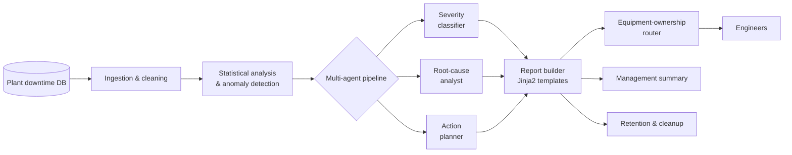
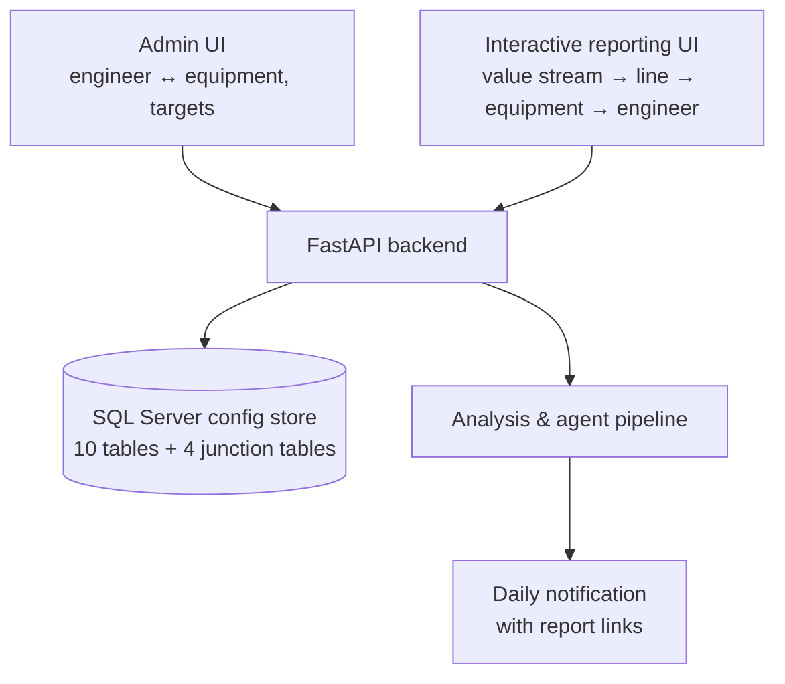

# Downtime Intelligence Platform

**Multi-agent AI for manufacturing downtime analysis, root cause and routing**

`Python` `LangGraph` `SQL Server` `Jinja2` `matplotlib` `FastAPI` · **Status:** in production, re-platforming to a web application

---

## The problem

Production lines generate thousands of downtime events. Engineers received generic reports, had to dig for the equipment they own, and root-cause analysis depended on whoever had time that week. Targets per line and equipment existed, but deviations were spotted late.

## The solution

An end-to-end platform that ingests downtime events, analyzes them statistically, lets a team of AI agents reason about severity and causes, and delivers the right report to the right engineer — automatically.

### Key capabilities
- **Anomaly detection** against per-line and per-equipment downtime targets.
- **LangGraph orchestration** of three specialized agents: severity classification, root-cause analysis and action planning.
- **Multiple report types** — daily, weekly, engineering and a target-deviation report (actual DT% vs. target % by value stream, line and equipment).
- **Three-level drill-down** (Line → Equipment → Category) with interactive collapse in HTML reports.
- **Ownership-based routing**: each engineer receives only the equipment they're responsible for; managers receive the plant-wide view.
- **Data-quality guards**: consistency-check banners, hidden trivial charts, case-normalized target lookups.

## Re-platform (in progress)

The first version ran on YAML configuration and scheduled scripts. To scale across value streams and hand configuration to non-developers, I designed its next generation:

- Relational schema fully designed (DDL, filtered unique indexes, seed data) to replace file-based config.
- One-time migration path from YAML to the database, per value stream.
- Notifications move from heavy email bodies to links into the interactive UI.

## Outcomes
- Engineers get **targeted, actionable reports** instead of plant-wide dumps.
- Root-cause and action suggestions are **generated consistently every cycle**, not only when someone has time.
- A full **13-document suite** (PRD, BRD, SRS, architecture, AI prompting guide, user and setup guides) became the template for later projects.

<!-- METRIC: add hours/week saved, number of engineers served, or downtime reduction if available -->

## What I learned
- Confirm foundational choices (database, schema, credentials) **before** building — re-platforming is cheaper on paper.
- Defensive data handling (None-safe config access, normalized keys) matters more than clever models in a live plant.

---
[← Back to portfolio](../README.md)
