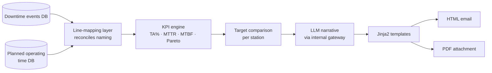

# Technical Availability Reporting Agent

**Weekly equipment availability analysis with AI-written narrative, delivered automatically**

`Python` `SQL Server` `LangChain` `LiteLLM` `Jinja2` `xhtml2pdf` · **Status:** in production (weekly schedule)

---

## The problem

Technical Availability (TA%) is the core health metric for equipment, but building the weekly report meant pulling from two databases, reconciling different line names, calculating KPIs by hand and writing commentary — every Monday.

## The solution

A scheduled pipeline that joins downtime events with planned operating time, computes the KPIs per station, and uses an LLM to write the narrative a manager would otherwise write.

### Key capabilities
- **KPIs:** TA%, planned operating time, MTTR, MTBF and Pareto of top downtime contributors per value stream.
- **Cross-source reconciliation** through a configurable line-mapping file.
- **Per-station targets** and thresholds in YAML; SQL kept in versioned `.sql` files; secrets in environment variables.
- **Value-stream-aware filters** with per-value-stream overrides and a default fallback — new value streams onboard through configuration, not code.
- **AI summary** routed through an OpenAI-compatible internal model gateway (LangChain + LiteLLM), so no data leaves the corporate boundary.
- **Dual output:** interactive HTML email plus a print-ready PDF built with a layout designed specifically for the PDF engine.

## Outcomes
- The weekly report runs **unattended every Monday morning**.
- Managers receive the numbers **and** the interpretation in one email.
- Full documentation set: README, user, technical and setup manuals, architecture diagram.

<!-- METRIC: hours saved per week, number of stations/value streams covered -->

## What I learned
- PDF engines have their own CSS dialect — a dedicated, table-based template beat trying to reuse the HTML one.
- Log *which* configuration path was used for every decision; it turns "why is this number different?" into a one-minute answer.

---
[← Back to portfolio](../README.md)
