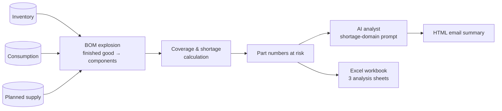

# Material Shortage Monitoring Agent

**BOM-driven shortage detection with an AI analyst layered on top**

`Python` `Oracle` `SQL Server` `pandas` `openpyxl` `LLM` · **Status:** in production (weekly schedule)

---

## The problem

Shortages are found too late when inventory, consumption and incoming supply live in different systems. Planners needed to know, every week, which finished goods were at risk because of which component — and why.

## The solution

A weekly pipeline that explodes the bill of materials, compares requirements against inventory and planned supply, and delivers a structured shortage report with an AI-generated analysis.

### Key capabilities
- **BOM explosion** linking every finished good to its components and coverage.
- **Three-sheet Excel output** with consistent component descriptions across every view.
- **AI layer** built incrementally on a working pipeline: LLM summaries, predictive analytics and interactive Q&A.
- **Domain-scoped prompting:** a dedicated shortage-analysis system prompt, decoupled from prompts used for other agents, to keep answers on-topic.

## Running AI inside a locked-down network
The agent runs on a corporate Windows server behind an authenticated proxy. To make scheduled LLM calls reliable, I:
- Moved the local proxy from a per-user startup app to a **Windows Service** under a service account.
- Fixed IPv4 resolution and **TLS certificate trust** for the corporate chain.
- Scheduled the job with Windows Task Scheduler, independent of any user session.

## Outcomes
- Planners receive a **weekly, prioritized at-risk list** with an explanation, in email and Excel.
- The infrastructure pattern (proxy as a service, scoped prompts) became reusable for other agents.

<!-- METRIC: number of part numbers monitored, shortages caught early, hours saved -->

## What I learned
- In enterprise AI, **infrastructure reliability is the feature** — a brilliant model that fails at 6 a.m. is worthless.
- Sanitize numeric edge cases (e.g. infinite coverage) before export; a file that won't open destroys trust instantly.

---
[← Back to portfolio](../README.md)
