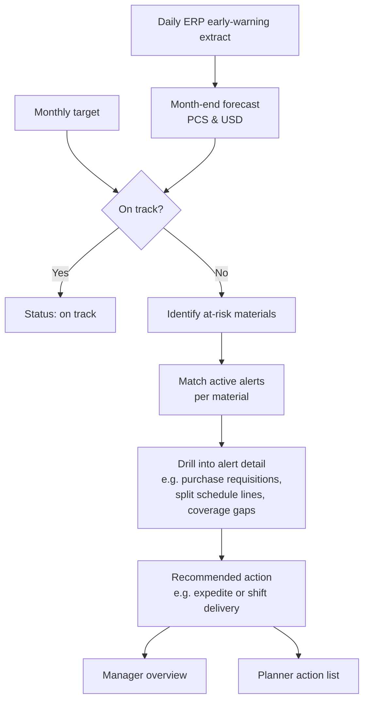

# Month-End Inventory Closing Forecast

**Forecast + diagnostic tree: from "are we on target?" to "what should the planner do today?"**

`Python` `Machine Learning` `SAP early-warning data` `HTML reporting` · **Status:** in development

---

## The problem

Logistics planning must close every month near an inventory value target. Planners only learned they were off-target late in the month, and finding *which* materials and *why* meant clicking through dashboards alert by alert.

## The solution

A standalone, daily tool that forecasts month-end raw-material inventory (pieces and USD, consignment + non-consignment) against the target — and then walks a root-cause tree down to a recommended action.

### Design decisions
- **Diagnosis over dashboards:** the deliverable is a decision tree, not a prettier chart.
- **Two views:** a one-glance managerial overview and a planner-level action list, grouped by each planner's material family.
- **Human in the loop:** the system surfaces each deviation with its value; the planner owns the decision.
- **AI as a required component**, combined with deterministic business rules for alerts.
- **Strict data governance:** production data stays in the local environment; the tool runs standalone with no calls to external AI services at runtime.

## Status
Business rules, alert logic, output views and daily cadence are defined; development is underway on synthetic data before moving to the local production environment.

<!-- METRIC: add forecast accuracy and month-end target variance once live -->

## What I learned
- Writing down the exact alert trigger rules with the business before modeling saved weeks of rework.
- Data-governance constraints shape architecture from day one — they are requirements, not obstacles.

---
[← Back to portfolio](../README.md)
