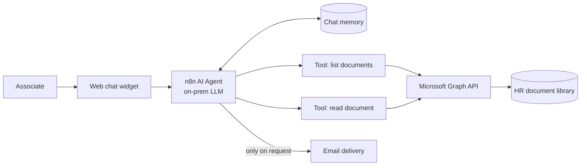

# HR Policy Q&A Assistant

**A conversational agent that answers associate questions from official HR documents**

`n8n` `AI Agent` `On-prem LLM (OpenAI-compatible)` `Microsoft Graph API` `SharePoint` · **Status:** functional in development environment

---

## The problem

HR received a constant stream of repetitive calls about two processes — the scholarship program and intern requests — even though the answers already existed in official documents.

## The solution

A low-code AI agent that reads the official document library on demand, answers in natural language with conversation memory, and emails the answer only when the associate asks for it.

### Key capabilities
- **Tool-using agent:** two sub-workflows exposed as tools — list available documents and read a document's content.
- **Microsoft Graph API over HTTP** instead of the native connector, for finer control over the document library.
- **Conversation memory** so follow-up questions keep context.
- **Branded web chat widget** for associates.
- **Opt-in email:** answers are sent by email only when explicitly requested.

## Outcomes
- Associates get **instant answers grounded in official documents**, at any time.
- HR is freed from repetitive first-level questions.

<!-- METRIC: questions answered, call reduction, number of documents covered -->

## What I learned
- Build incrementally and validate each node before adding the next — agent workflows fail silently otherwise.
- Know when to stop: a chat-platform integration was explored and **deliberately dropped** because it required directory permissions outside the team's control; the web widget delivered the value without the dependency.

---
[← Back to portfolio](../README.md)
