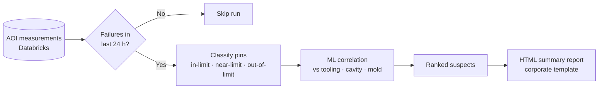

# AOI Pin-Position Escape Analysis

**Linking near- and out-of-limit pin positions to tooling, cavities and molds**

`Databricks` `Python` `Machine Learning` `HTML reporting` · **Status:** in development

---

## The problem

Automated optical inspection (AOI) measures pin positions on every unit. Out-of-limit pins are caught, but the *near-limit* ones are early warnings — and nobody had a fast way to tell whether a drift came from a specific tool, cavity or mold.

## The solution

An event-driven analysis that runs only when there were failures in the last 24 hours, uses ML to correlate pin deviations with manufacturing tooling, and publishes a concise report per analysis.

### Design decisions
- **Event-triggered, not calendar-triggered:** no failures, no noise.
- **Two query families** cover the four production lines according to their data structure.
- **Near-limit focus** turns inspection data into a predictive quality signal, not just a reject list.
- **One report per analysis** in the corporate report format, so it drops straight into existing quality reviews.

<!-- METRIC: once live — escapes prevented, time to identify a tooling cause -->

## What I learned
- Quality engineering experience matters: knowing that cavity and mold are the usual suspects shaped the feature set more than any algorithm choice.

---
[← Back to portfolio](../README.md)
