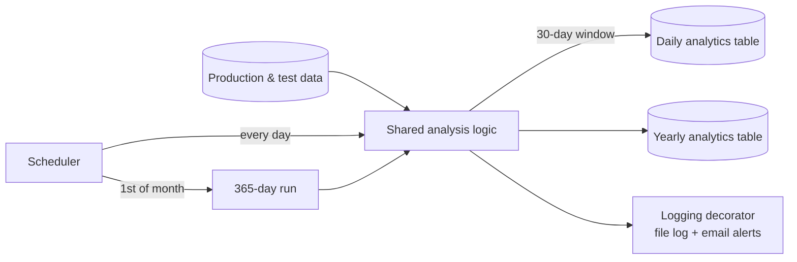

# Failure WIP Inventory Pipeline

**Daily and yearly analytics loads on failed-unit inventory, with observability built in**

`Python` `SQL Server` `Scheduling` `Logging & alerting` · **Status:** in production

---

## The problem

Units that fail test and sit in work-in-progress inventory tie up money and hide quality issues. Teams needed a reliable, up-to-date analytical table — plus a long-term view for trend analysis.

## The solution

A production pipeline with two loads that share one schema and one set of business logic.

### Design decisions
- **One logic, two horizons:** the yearly table reuses the exact schema and code path as the daily one, so the two never disagree.
- **Calendar-aware scheduling:** the 365-day run fires automatically only on the first day of each month.
- **Observability as a decorator:** a reusable logging/email handler wraps pipeline functions so failures are recorded and announced.

## Outcomes
- Downstream reports and dashboards run on **fresh daily data and a consistent yearly history**.

<!-- METRIC: rows processed, report consumers, value of WIP tracked -->

## What I learned
- Monitor the monitor: a log that silently stops being written is worse than no log. Verifying log freshness is now part of my pipeline checklist.

---
[← Back to portfolio](../README.md)
