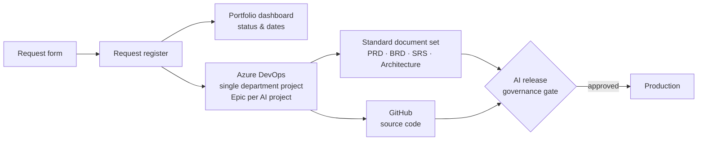

# AI/DS Delivery Standard

**The operating model every AI and data science project in the department now follows**

`Azure DevOps` `Power BI` `Microsoft Forms` `GitHub` `Microsoft 365` · **Status:** department standard since October 2026

---

## The problem

The department was delivering a growing number of AI projects, but each one was requested, tracked and documented differently. Code lived in GitHub; everything else — requirements, status, governance evidence — was scattered. Leadership had no single view of the portfolio.

## The solution

An end-to-end ecosystem that takes a project from idea to production with one set of tools, templates and gates.

### What the standard defines
- **Intake:** one request form; approved requests feed a register that powers the portfolio dashboard.
- **Tracking:** a single Azure DevOps project for the whole department, one Epic per AI project, consistent work-item structure and IDs.
- **Documentation:** reusable templates — PRD, BRD, SRS, architecture with diagrams, user and setup guides, and an AI prompting guide for LLM-based systems. I packaged this suite so it can be generated consistently for any new project.
- **Governance:** the corporate AI release checklist and risk classification as a **mandatory gate** before go-live.
- **Language:** English as the standard for all templates and documentation.

## Why it matters
- Requesters from other areas get a **clear, predictable path** into the AI team.
- Leadership gets **one portfolio view** with status and dates.
- Every project ships with the same documentation and governance evidence — **audits become routine instead of fire drills.**

## Leadership takeaway
Building the standard meant reusing what the organization already had (forms, registers, dashboards) and connecting it, rather than introducing new tools. Adoption is easier when the standard feels familiar.

---
[← Back to portfolio](../README.md)
